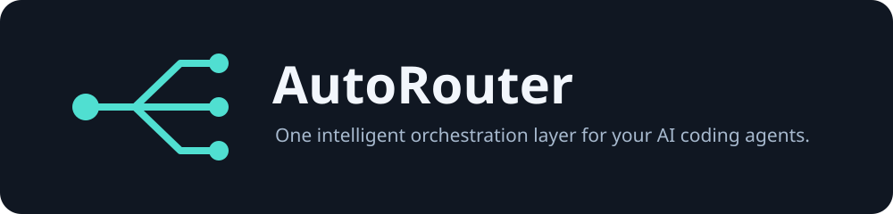
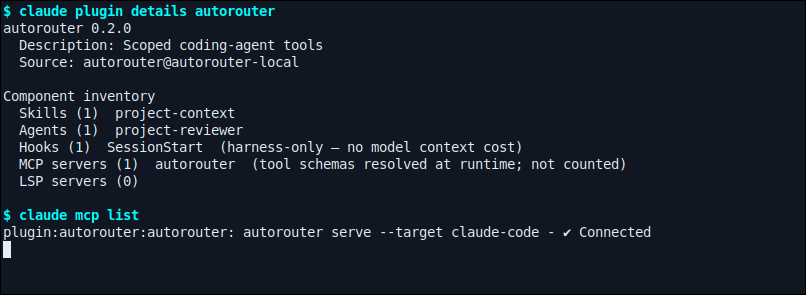
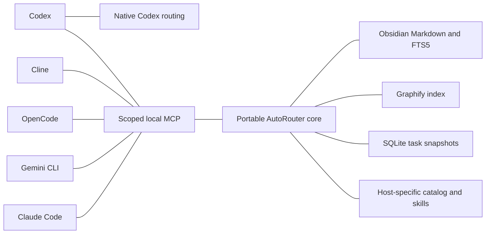

# AutoRouter



AutoRouter gives coding agents a shared way to retrieve project decisions, inspect code relationships, and resume work from explicit checkpoints. Each agent keeps its interface, account, model controls, and approvals.

- Search approved Obsidian Markdown with SQLite FTS5, or query Graphify for source-backed code relationships.
- Share task snapshots across authorized agents using local MCP and inspect progress with [AutoRouter Pulse](docs/performance.md).
- Discover approved skills and get routing recommendations using each host’s own catalog.
- Use the optional native Codex build for Luna-first classification, reasoning selection, and real execution-stage model changes.

## Compatibility

| Host | Integration | Routing | Verification |
| --- | --- | --- | --- |
| Codex | Native Rust patch and scoped MCP | Native Luna-first execution switching where the catalog and approvals permit it | Linux native TUI and live authenticated task, focused Rust tests |
| Claude Code | Local plugin with skills, session hook, reviewer and MCP | Recommendation with host model picker | Beta. 2.1.329 loaded skill, agent, hook and MCP on Linux. Authenticated session pending |
| Gemini CLI | Native extension with skill and MCP | Recommendation with host model picker | Beta. 0.70.0 validated, linked, and connected on Linux |
| OpenCode | 1.x local plugin and native MCP | Recommendation with host model picker | Beta. 1.19.6 connected on Linux |
| Cline | Local stdio MCP | Recommendation with host model picker | Beta. 3.0.74 CLI registration and removal, authorized tool call through Cline runtime |

`autorouter hosts` emits the machine-readable capability matrix and executable discovery. See [adapter details](docs/host-adapters.md) and [test evidence](docs/benchmarking.md).

## Quick start

With Python 3.11 or later and one host already installed:

```sh
python -m pip install .
autorouter hosts
cd path/to/a/trusted/project
autorouter workspace --target claude-code --vault /path/to/approved-notes
autorouter install --target claude-code
claude
```

On macOS and Linux, install into an isolated environment with `pipx install .` if the system Python is externally managed. On Windows use an activated virtual environment or pipx and put its scripts on PATH. See [installation and rollback](docs/installation.md).

Ask the agent to use AutoRouter's `knowledge_search` for a specific project decision and confirm the cited note. Tests use the synthetic query “Saturn” against a one-note fixture. See [reproduce the demo](docs/benchmarking.md).



## Architecture



- [Architecture](docs/architecture.md), [core and adapter contract](docs/universal-core.md), [configuration](docs/configuration.md)
- [Routing](docs/model-routing.md), [catalogs](docs/model-discovery.md), [handoffs](docs/task-handoffs.md)
- [Shared memory](docs/memory.md), [Graphify](docs/graphify.md), [skills](docs/skills.md)
- [Security](docs/security.md), [troubleshooting](docs/troubleshooting.md), [roadmap](docs/roadmap.md)
- [Performance](docs/benchmarking.md), [contributing](CONTRIBUTING.md), [changelog](CHANGELOG.md)

AutoRouter is independent software. The optional Rust adapter includes changes to OpenAI Codex under Apache-2.0. Graphify, Obsidian, Ponytail, Agent Skills, ECC, CLI-Anything and REA are independent integrations installed from their own sources. [License](LICENSE) · [Attribution](NOTICE)
